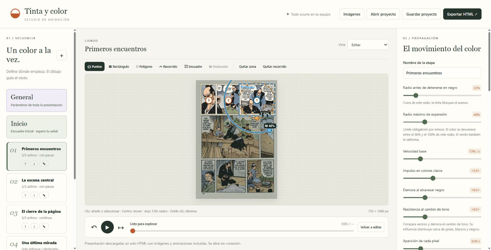

# Tinta y color

Editor local para animar la aparición del color en dibujos con tinta, acuarela y otras técnicas. Parte de una imagen inicial y otra coloreada; permite dirigir la propagación y exportar una presentación web que funciona sin conexión.



## Empezar

1. Descarga o copia el proyecto completo, conservando sus carpetas.
2. Abre [index.html](index.html) en Chrome o Edge. No requiere instalación, servidor ni conexión.
3. Prueba el ejemplo incluido o carga tus imágenes desde **Imágenes**.
4. Define etapas, zonas, puntos y recorridos; ajusta la propagación y reproduce.
5. Usa **Guardar proyecto** para seguir editando y **Exportar HTML** para presentar.

El editor prepara y alinea las imágenes. También puede generar una base desde la versión coloreada con **Tinta y líneas (L)**, que combina fondo robusto, protección de trazos finos y recuperación de líneas, con controles para retirar pigmentos, ajustar grises y comparar el resultado antes de aplicarlo. Los puntos admiten orden, activación, demoras y radios propios. Las etapas pueden pintar o cambiar únicamente el enfoque y el destacado, con transiciones graduales, desfase inicial de pintura y permanencia. **General** permite revisar y unificar parámetros de toda la presentación antes de aplicarlos. Puedes deshabilitar etapas y usar Ctrl + clic para editar un grupo de ellas. La exportación ofrece fondo achurado, liso o transparente, sin marco ni sombra alrededor del dibujo. Sus controles comienzan ocultos y se muestran con el logo o la tecla H. Un clic en el dibujo inicia o avanza la presentación; Espacio permite pausar y continuar. Al terminar, un botón de reinicio con alto contraste permite regresar a Inicio.

## Uso desde una IA

La automatización opcional ofrece una API local, comandos y un servidor MCP con siete herramientas. Un asistente con visión puede crear proyectos desde imágenes y planes JSON, preparar y revisar la base sin calcular la animación, y exportar el HTML. Requiere Node.js 22 o posterior y Chrome/Edge/Chromium para preparar o renderizar; no usa paquetes externos. El editor conserva su apertura directa sin instalación.

Consulta la [guía de automatización y conexión MCP](docs/automatizacion.md), el [contrato del plan](schemas/animation.schema.json) y la [guía para asistentes](docs/para-ia.md).

## Documentación y ejemplos

- [Guía de uso](docs/guia-de-uso.md): herramientas, tiempos, radios, cámara, destacado y presentación.
- [Arquitectura y desarrollo](docs/arquitectura.md): responsabilidades, algoritmo y comandos opcionales.
- [Formato del proyecto](docs/formato-del-proyecto.md): datos guardados y compatibilidad.
- [Verificación](docs/verificacion.md): comprobaciones realizadas y límites.
- [Cambios por versión](CHANGELOG.md).
- [Proyecto editable de ejemplo](examples/ejemplo.colorflow.json): ábrelo desde **Abrir proyecto**.
- [Presentación de ejemplo](examples/presentacion-ejemplo.html): un único HTML con las imágenes y el reproductor incorporados.

## Estructura

```text
index.html       Entrada del editor
src/             Código JavaScript
assets/          Estilos del editor
automation/      API local, comandos, servidor MCP y renderizador
schemas/         Contrato de planes para automatización
examples/        Imágenes, datos incorporados, proyecto y presentación
tests/           Pruebas del navegador y de automatización
docs/            Guías, referencias, capturas y prompt de coloreado
scripts/         Utilidades opcionales para desarrollo
```

No se usan bibliotecas externas ni pasos de compilación. Abre [tests/index.html](tests/index.html) para ejecutar las pruebas del navegador. Con Node.js 18 o posterior también puedes ejecutar los casos sin DOM:

```sh
node scripts/ejecutar-pruebas.mjs
```

## Licencia y recursos

La licencia del código está pendiente de elección. Las imágenes de ejemplo tienen su procedencia documentada por separado en [licencia y recursos](docs/licencia-y-recursos.md).

La preparación de imágenes ofrece Oscurecer (M) y Multiplicar (N), comparación con zoom/posición compartidos, miniatura navegable y recálculo por bloques que prioriza el detalle visible. Una luz con texto indica cuándo el detalle o toda la imagen están actualizados. Los proyectos anteriores conservan su método.

El destacado separado permite varios rectángulos por etapa o en Inicio: Ctrl + arrastrar agrega otro; la lista y las asas permiten editarlo. El exterior de su unión recibe el tratamiento elegido. El enfoque permanece independiente y el HTML autónomo conserva todos los rectángulos.
