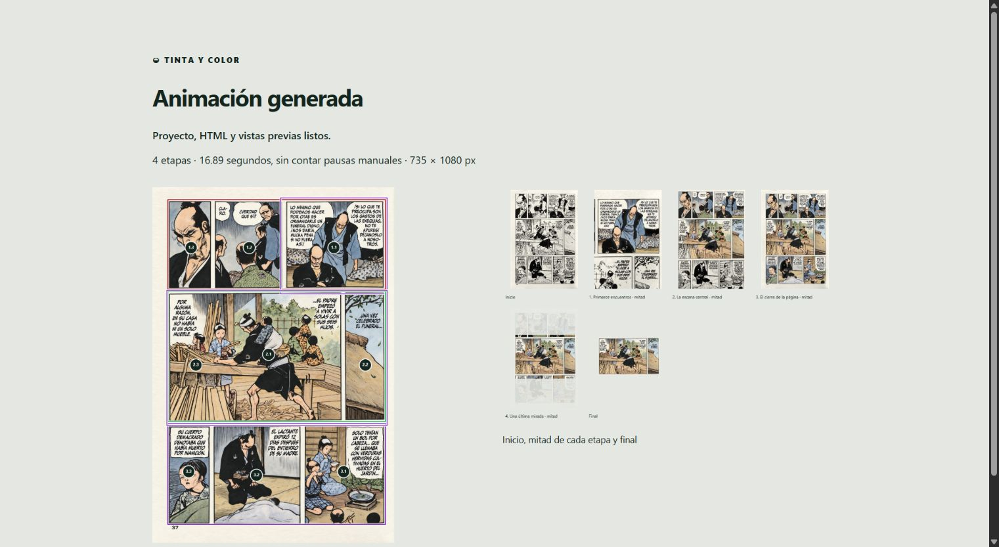

# Automation and AI integration

**English** | [Español](../automatizacion.md)

[Back to the project](../../README.md)

Tinta y color provides a local Node.js API, CLI commands and an MCP server over `stdio`. All three use the same format, engine, image preparation and HTML builder as the editor. They do not include an AI model: a vision-capable assistant interprets the request and uses these operations to carry it out.

The editor still works without Node.js. Exported HTML does not need automation to play.

Get the [complete package](distribution.md#complete-package) for API, CLI or MCP. The editor ZIP contains only the portable application.

## Named draft and suggested destination

Use `plan.name` when creating a project. Keep the original, e.g. `windsurf-draft.colorflow.json`. `review` accepts optional `name` and `saveAs`, a `.colorflow.json` file path inside the authorized root. The suggested destination is not created or written and grants no browser permission. The result includes `name` and `saveSuggestion` with `fileName`, `directory` and `path`.

```sh
node automation/cli.mjs review --project windsurf-draft.colorflow.json --out windsurf-edit.html --name "Windsurf history" --save-as animations/windsurf.colorflow.json --open
```

MCP: `colorflow_review` accepts the same `name` and `saveAs` fields. Without `saveAs`, it proposes a project-derived filename beside the draft and avoids matching the source file. A name passed to review is embedded in the editor without changing the source project. The editor supports Save, Save as and Undo/Redo; JSON files use format 11 (also reads 1–10). History exists only in the editor and is not exposed through MCP. Read user-corrected files before making changes. This remains file exchange, not a live session connection.


## Setup

1. Install **Node.js 22 or later** for automation. [Node.js 24 LTS](https://nodejs.org/en/about/previous-releases) is recommended.
2. Install Chrome, Edge or Chromium for calculation and export. Common installation locations are detected; use `--browser` with an absolute executable path for another location.
3. Keep images in the working directory. Conversation attachments must be accessible there to the local client.

No `npm install` is required: there are no external packages. Run commands from the repository or complete-package root. The examples below use additional repository files; the ZIP includes `AUTOMATION.md` with instructions using your own images. The renderer starts a headless browser with its own temporary profile. It serves only the job on `127.0.0.1`, using an ephemeral port and random path, then shuts down. Your regular browser profile is unchanged.

## Try a single image

```sh
node automation/cli.mjs create --image examples/images/samurai-final.png --plan examples/plans/recorrido-simple.json --out output/mi-proyecto.colorflow.json
node automation/cli.mjs validate --project output/mi-proyecto.colorflow.json
node automation/cli.mjs render --project output/mi-proyecto.colorflow.json --out output/mi-presentacion
```

The included plan zooms in without painting, reveals color, then returns to the full page. Without an initial image, ink on paper is generated from the final image. Detectable pigments become paper; neutral mid-grays and solid blacks are retained. Detection is approximate and must be checked. Supplying only a black-and-white photo does not make the tool invent missing colors.

With two images:

```sh
node automation/cli.mjs create --image examples/images/samurai-final.png --initial examples/images/samurai-inicial.jpg --plan examples/plans/recorrido-simple.json --out output/dos-imagenes.colorflow.json
node automation/cli.mjs render --project output/dos-imagenes.colorflow.json --out output/dos-imagenes --auto-align
```

`--auto-align` estimates position, scale and rotation before calculation. The output project retains that alignment. Without this option, the saved project alignment is used.

Each render outputs:

| File | Contents |
| --- | --- |
| `presentacion.html` | Self-contained presentation with no external resources. |
| `proyecto.colorflow.json` | Complete project for opening and refining in the editor. |
| `informe.json` | Calculated duration, dimensions, stage timings and warnings. Excludes pauses awaiting input. |
| `base.png` | Complete prepared base, without the initial view, camera or highlighting. |
| `plan.png` | Colored reference with regions, paths, frames and numbered points (stage.point). |
| `storyboard.png` | Initial view, midpoint of each enabled stage, and final view. |
| `inicio.png`, `final.png`, `etapa-NN.png` | Individual frames with camera and highlighting applied. |



## Prepare the base without calculating the animation

The plan/project `baseGeneration` object controls pigment, gray and paper treatment. Values are fractions: `smoothness: 1` is 100% in the editor. See [project format](project-format.md) for fields and limits.

```sh
node automation/cli.mjs create --image examples/images/samurai-final.png --plan examples/plans/base-tinta.json --out output/proyecto-base.colorflow.json
node automation/cli.mjs prepare --project output/proyecto-base.colorflow.json --out output/base
```

`prepare` decodes images, optionally applies `--auto-align` to an uploaded initial image, and writes `base.png`, `referencia.png`, `comparacion.png`, `proyecto.colorflow.json` and `informe.json`. It does not calculate propagation or produce HTML. The report sets `imageDecodingChecked: true` and `calculationChecked: false`.

To try another transformation, use `update` with a patch containing `baseGeneration`, then prepare into a new directory. The patched object replaces the complete configuration; omitted fields within it receive defaults. In older projects, `method: "grayscale"` preserves the original desaturation. Use `baseGeneration: { "method": "protected" }` for L; [base-lineas.json](../../examples/plans/base-lineas.json) contains recommended values. New projects already use L; format 7 retains ink when opened.

The API provides the same operation: `await api.prepare({ project, outputDir })`. In MCP, use `colorflow_prepare`, then `colorflow_read_image` on `base.png`. Output projects use format 10 and retain all generation parameters. Full rendering also includes `base.png`.

## Commands and errors

```sh
node automation/cli.mjs inspect --project output/mi-proyecto.colorflow.json
node automation/cli.mjs update --project output/mi-proyecto.colorflow.json --plan cambios.json --stage 1
node automation/cli.mjs schema
node automation/cli.mjs --help
```

`inspect` returns the complete plan and image names without dumping large base64 blocks. `update` patches a stage when `--stage` is supplied (zero-based); otherwise it patches the project. Omitted fields are retained. Included objects and lists replace their entire field: for example, `stages` replaces the full sequence and `points` all points in that stage.

`update` modifies the same file by default. Use `--out copia.colorflow.json` to keep the original. `create`, `prepare` and `render` reject existing outputs unless `--force` is supplied. Repeating preparation or rendering with `--force` replaces current artifacts; it does not delete additional files in the directory.

Paths are resolved relative to `--root`, which defaults to the current directory. Paths and links leading outside it are rejected. Choose a working directory containing only files you want the assistant to access.

Successful responses are JSON on stdout. Failures are JSON on stderr with exit code 1. `validate` also returns code 1 for invalid values. Details identify the field, for example `$.stages[0].points[0].x`. Structural validation does not decode images or calculate propagation; `render` performs those steps and may detect further errors.

The default rendering timeout is 120 seconds; `--timeout` accepts 1000–600000 milliseconds. Input images are limited to 40 MB, project JSON to 150 MB, and the browser response to 256 MB. Editor resolution and emitter limits still apply.

## Connect an assistant over MCP

For new bases, use `baseGeneration.method: "protected"` (L). Preparation analyzes the original at up to 1600 px on its longest side before reducing to animation resolution; reports include `baseSourceSize`. No extra libraries or image service are required.

The server uses [MCP stdio](https://modelcontextprotocol.io/specification/2025-11-25/basic/transports). Your client must be able to start local processes and read images; not every web assistant supports this connection.

Configure the client with an equivalent block, replacing both paths with absolute paths on your computer:

```json
{
  "mcpServers": {
    "tinta-y-color": {
      "command": "node",
      "args": [
        "/path/image-color-flow/automation/mcp.mjs",
        "--root",
        "/path/working-directory"
      ]
    }
  }
}
```

On Windows, you can use `C:/Users/your-user/GitHub/image-color-flow/automation/mcp.mjs`. If `node` is not on the client's PATH, provide the absolute path to `node.exe`. The exact configuration depends on the client; nothing is automatically installed in an assistant and its permissions are not changed.

For a browser in another location, add `"--browser", "/path/to/executable"` to `args`. The working root can differ from the repository: images and projects are read from that root; scripts resolve relative to their installation.

| Tool | Operation |
| --- | --- |
| `colorflow_create` | Create a project from a final image, optional initial image and plan. |
| `colorflow_inspect` | Get the editable plan and image names. |
| `colorflow_update` | Change parameters or a stage via `stageIndex`. |
| `colorflow_validate` | Check structure, ranges and geometry. |
| `colorflow_prepare` | Generate and inspect the base without calculating the animation. |
| `colorflow_render` | Generate HTML, project, report and previews. |
| `colorflow_read_image` | Return a source or preview as an image to the model. |

The server also exposes `colorflow://schema/plan` and `colorflow://guide` resources. It returns structured content and tool errors, supports render cancellation and closes jobs when the client disconnects. Only local `stdio` transport is implemented: there is no remote MCP endpoint, account system or provider key requirement. MCP tool descriptions, automation errors and the `colorflow://guide` runtime resource remain in Spanish; the English guide is [for-ai.md](for-ai.md).

Example request after connecting:

> Read the Tinta y color guide. Use `imagen.png`, first show the full page, zoom in on the central character, and reveal color from their clothing toward the background. Pause before the closing stage. Inspect the previews and deliver the HTML and editable project in `output/resultado`.

Interpreting “character” or “clothing” depends on the vision-capable assistant. The server does not perform semantic segmentation or use natural language to decide the animation: it executes the explicit plan prepared by the AI. The result remains offline; the assistant may need a connection while creating it.

## Node.js and browser API

```js
import { createAutomation } from './automation/api.mjs';

const api = await createAutomation({ root: '/path/working-directory' });
await api.create({
  image: 'imagen.png', output: 'output/proyecto.colorflow.json',
  plan: { stages: [{ name: 'Color', points: [{ x: 0.5, y: 0.5 }], maxRadius: 1 }] }
});
const result = await api.render({
  project: 'output/proyecto.colorflow.json', outputDir: 'output/presentacion'
});
console.log(result.artifacts);
```

Methods are asynchronous. `render` accepts an `AbortController`'s `signal`. Errors have `code`, `message` and `details`. The [JSON schema](../../schemas/animation.schema.json) defines the plan; image paths, outputs and execution options are separate arguments.

In a browser loading `engine`, `ink-lines`, `base-generation`, `project`, `preparation`, `view`, `player`, `codec`, `presentation` and `automation`, `PaintAutomation.prepare(project)` returns the normalized project, prepared images and report without propagation. `PaintAutomation.compile(project)` adds calculated fields and HTML. `previews(compiled)` generates frames and `contactSheet(checkpoints)` creates the storyboard. They require neither mounting the editor nor simulating clicks. Preparation needs Canvas; compilation also needs Web Workers.

Run automation tests with `node tests/automation.test.mjs`; `npm test` also runs the engine tests without a DOM. Actual checks and their limits are recorded in [verification](verification.md).

### Ink matching

Matching runs after L/K (`baseGeneration.inkMatch`, default `none`):

- `source-to-base`: every non-white base pixel receives the original image's RGBA at that position. This can restore color where K detected ink.
- `base-to-final`: copies those base pixels to the colored image prepared for animation. This legacy literal copy may slightly change the final strokes.
- `darken` (M): per-channel minimum with the base, without lightening the original.
- `multiply` (N): per-channel product with the base divided by 255; usually darker.
- `none`: keeps the generated base and colored image without matching.

Matching runs after scaling to animation resolution and applying the L/K controls, including soft edges. “Non-white” means darker than generated paper (including gray 254 on white paper); warm paper uses its generated tone as the reference. Literal copying and source-to-base make selected pixels equal; M/N composite colors and do not guarantee stationary ink. Retained gray pigment is included too. Matching only affects L/K and derived bases. Embedded originals remain intact: each preparation starts from them again, so changing or disabling matching does not accumulate changes. Reports include `inkMatchPixels`; `referencia.png` shows the colored copy used for animation.

Example plan: `"baseGeneration": { "method": "protected", "inkMatch": "source-to-base" }`. Create or update it through API, CLI or MCP; no additional operation is needed.

L is `method: "protected"`; K remains `"coherent"`. Format-8 projects retain K and their previous matching. API/CLI/MCP preparation returns complete images through the shared engine; viewport prioritization only applies to the editor preview.

### Multiple highlights

In a stage or `initialView`, set `highlightEnabled: true`, `highlightLinked: false` and `highlightFrames: [{"x":0.1,"y":0.15,"width":0.25,"height":0.3},{"x":0.6,"y":0.5,"width":0.25,"height":0.3}]`. `outside`, `outsideColor` and `blur` control the common outside treatment. A patch replaces the complete list; rectangles are not patched by index. All rectangles must be inside the image, with at most 64.

`frame` remains the camera framing. Legacy `highlightFrame` is accepted; a stage patch containing only that field replaces the list with one element (or empties it for null). If both are provided, `highlightFrames` takes precedence. Editor, API, CLI and MCP share these rules. See [destacados-multiples.json](../../examples/plans/destacados-multiples.json). The current editable format is 10.

## Open drafts and export for embedding

`colorflow_review` generates a self-contained editor and requests opening it (`open:true` by default). CLI: `review --project draft.colorflow.json --out edit.html --open`. Generation does not calculate propagation; `open:false` only delivers the file. Use `presentation.mode: "integrated"` to include the controller and example in `render`. See [drafts and embedding](embedding.md).
