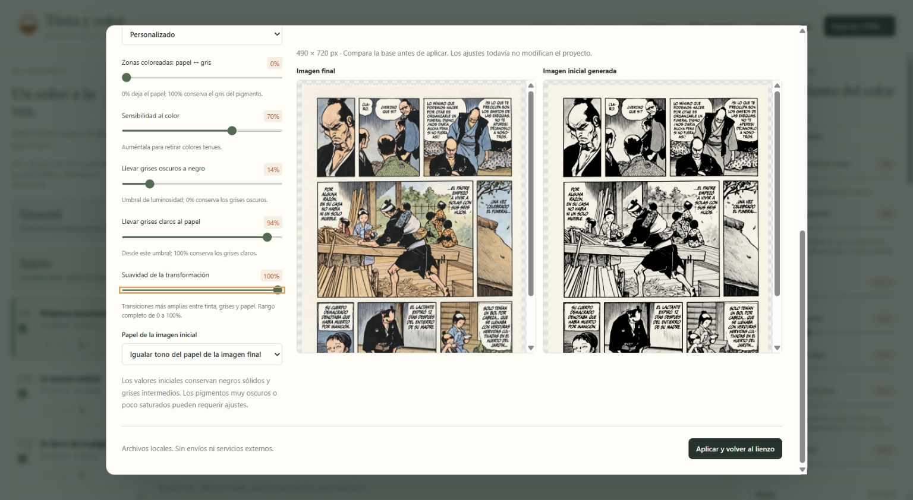
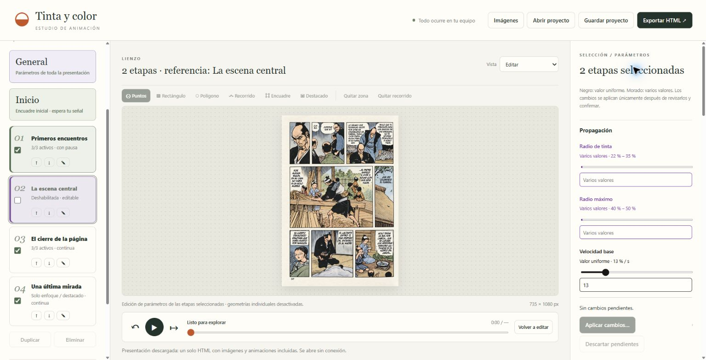
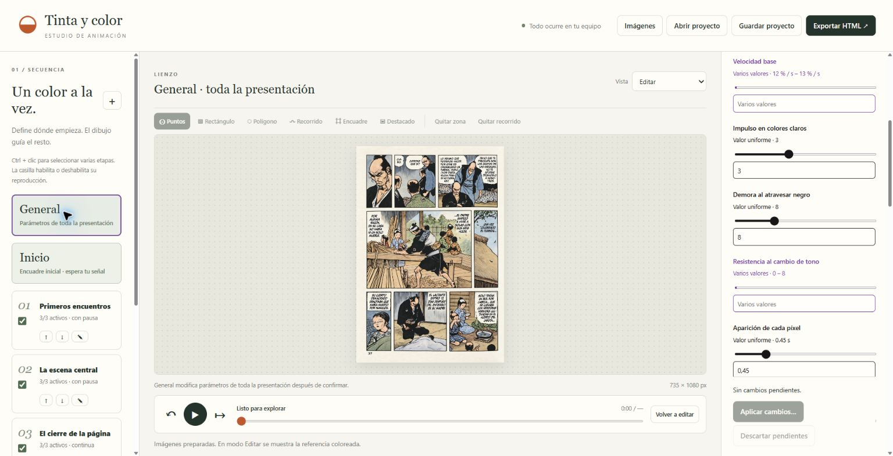
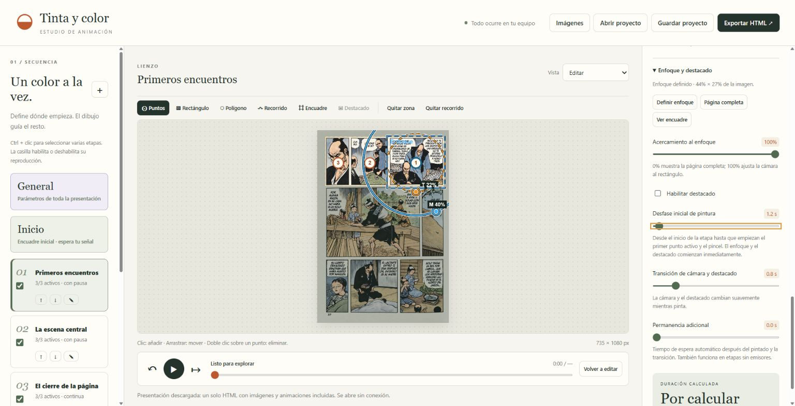
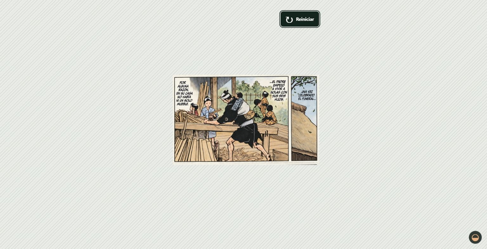

# Guía de uso

[Volver al proyecto](../README.md)

## Abrir

Abre [index.html](../index.html) en Chrome o Edge. Conserva la estructura completa de carpetas al copiar o descomprimir el editor. El ejemplo se incluye en `examples/demo-data.js` para no tener que leer imágenes locales mediante peticiones web.

1. En **Imágenes**, carga la versión coloreada y opcionalmente la inicial.
2. Elige entre neutralizar el papel del archivo inicial o generar una base de tinta sobre papel desde la final. Genera la vista previa y ajusta la transformación antes de aplicar. Con dos imágenes puedes alinear automáticamente sus contornos y afinar posición, escalas y giro con una superposición de referencia.
3. Crea etapas y ordénalas con las flechas de la lista. Para renombrar, haz doble clic en el nombre, usa el lápiz o edita el campo del inspector. Enter guarda y Escape cancela.
4. Delimita cada zona con un rectángulo o polígono. El polígono se cierra con **Enter** o doble clic; **Escape** cancela los vértices pendientes.
5. Con **Puntos**, haz clic para añadir y arrastra para mover. Un doble clic sobre un punto lo elimina; también puedes eliminarlo desde el inspector.
6. En la lista de puntos, usa ↑/↓ para ordenarlos y la casilla para activarlos o desactivarlos. Elige su modo de inicio y demora. Después de calcular verás los instantes de inicio y fin.
7. Opcionalmente, arrastra con **Recorrido**. El pincel se desplaza por ese trazo y deja propagación detrás. Puntos y recorrido pueden coexistir; desactiva los puntos si quieres que solo pinte el pincel.
8. Ajusta velocidades, ambos radios, resistencia al tono y viento. Reproduce para calcular y ver la animación. Cada etapa puede esperar un clic o una tecla antes de continuar.
9. Selecciona **Inicio** para definir la vista que verá el público antes de comenzar. En cada etapa, **Encuadre** delimita el enfoque y el control de acercamiento regula el zoom. **Habilitar destacado** permite tratar el exterior de ese rectángulo o dibujar otro independiente.
10. Descarga el **proyecto** para retomarlo y **Exportar HTML** para presentar.

En **Editar**, el lienzo muestra la imagen final como referencia con las guías encima; **Imagen inicial** permite revisar la base preparada. La reproducción comienza desde esa base.

## Generar la imagen inicial

En **Imágenes**, elige **Generar imagen inicial desde la imagen final** y pulsa **Generar vista previa**. El panel muestra la referencia y la base propuesta una junto a otra, sin superponerlas. Una vez generada, los controles actualizan la comparación automáticamente. **Ampliación** y los botones Ajustar/−/+ afectan ambas vistas. Arrastrar cualquiera o usar su rueda mueve o amplía las dos; la miniatura permite centrar con clic o arrastrar el rectángulo. El encuadre se conserva al regenerar.

Hay cinco puntos de partida: **Tinta y líneas (L)** es la opción recomendada (añade protección de superficies oscuras conectadas); **Tinta y líneas (K)** conserva el método anterior, con fondo robusto, protección de detalles finos y recuperación de líneas.  **Tinta sobre papel** retira pigmentos detectables, **Tinta y grises suaves** conserva parte de su gris y **Desaturación anterior** reproduce el método antiguo, que conserva sombras. Al modificar los controles aparece **Personalizado**. Los nuevos proyectos usan L; formato 8 conserva K incluso sin método explícito. Los archivos de formato 7 mantienen su filtro de tinta; formatos 1–6 mantienen la desaturación. Para usar L en un proyecto existente, selecciónalo en Punto de partida y revisa la nueva base antes de aplicar.

| Control | Funcionamiento |
| --- | --- |
| Zonas coloreadas: papel ↔ gris | 0% lleva el pigmento detectado al papel; 100% conserva su gris. |
| Sensibilidad al color | En K, auméntala para descartar contrastes débiles de pigmento/textura, con posible pérdida de trazos. En Tinta sobre papel detecta pigmentos más tenues. |
| Llevar grises oscuros a negro | Luminosidad por debajo de la cual se refuerza a negro. 0% conserva los grises oscuros. |
| Llevar grises claros al papel | Luminosidad a partir de la cual se aclara al papel. 100% conserva los grises claros. |
| Suavidad de la transformación | De 0 a 100%. En K parte de 0% y añade un suavizado de acabado; puede reducir nitidez. En el filtro anterior parte de 8% y amplía las transiciones entre pigmento, gris y papel. |
| Papel | Tono estimado del papel de la imagen final o blanco puro. |

K retira los rellenos, conserva negros sólidos y recupera detalles usando el entorno y la continuidad de los trazos. El filtro anterior conserva por defecto los grises intermedios. Se evalúan luminosidad y diferencia de canales para evitar que un azul oscuro se convierta automáticamente en tinta negra. La detección es aproximada: pigmentos casi neutros o muy oscuros pueden requerir ajustes. Los controles de tinta no actúan en Desaturación anterior; el papel sigue siendo seleccionable.

**Aplicar y volver al lienzo** guarda el método y sus parámetros. Si todavía no generaste la comparación, el primer clic la genera y mantiene abierto el diálogo para revisarla. Cerrar con × o Escape descarta los cambios pendientes. **Descargar imagen inicial PNG** permite guardar la base completa que estás revisando, sin enfoques ni destacados. La inicial cargada como archivo no recibe estos controles.

K analiza el original hasta 1600 px de lado mayor y después reduce la base a la resolución elegida para la animación. De este modo, elegir 720 px no reduce de antemano los detalles que necesita detectar. El estado de la vista previa indica ambas dimensiones. La generación puede tardar unos segundos en imágenes grandes.

## Habilitación y selección de etapas

La casilla de cada etapa en la columna izquierda controla su reproducción. Al deshabilitarla se conserva toda su configuración y sigue siendo editable, pero no pinta ni participa en el enfoque, destacado, transición, permanencia o pausa. La cámara y el color acumulado pasan entre las etapas habilitadas. Si ninguna está habilitada se mantiene la vista Inicio.

- **Clic normal** sobre el nombre: selecciona una sola etapa.
- **Ctrl + clic** sobre el nombre: añade o quita esa etapa del grupo. Siempre queda al menos una etapa seleccionada.
- La casilla de habilitación no cambia el grupo seleccionado. También puedes seleccionar etapas deshabilitadas.
- General e Inicio se seleccionan individualmente.

Con varias etapas seleccionadas, el inspector usa los mismos controles y la misma revisión de General, pero limita el resumen y la aplicación al grupo elegido. La confirmación indica cuántas etapas y puntos se modificarán. Los radios vuelven a heredarse únicamente en los puntos de esas etapas. Inicio no forma parte de una selección múltiple.

El lienzo muestra como referencia la última etapa seleccionada que permanezca en el grupo. Las herramientas de dibujo, el nombre y las geometrías se editan al seleccionar una sola etapa. El grupo se conserva al reordenar etapas y al aplicar la preparación de imágenes.

Los pendientes del grupo y los de General son independientes. Cambiar los miembros del grupo o pasar a Inicio o General descarta los pendientes de la selección; los pendientes de General se conservan al navegar, como antes. Ninguna modificación pendiente se guarda sin confirmarla.

## General

**General** aparece antes de Inicio y no forma parte de la reproducción. Reúne los parámetros de propagación, radios, viento, pincel, puntos, enfoque, destacado y tiempos. Los nombres y las geometrías se editan individualmente.

- **Negro / Valor uniforme**: todos los destinos usan el mismo valor.
- **Morado / Varios valores**: hay diferencias. Los parámetros numéricos muestran su intervalo; no se presupone un valor intermedio.
- Los radios también consideran los valores propios de los puntos, incluidos los desactivados.

Modifica uno o varios controles y pulsa **Aplicar cambios…**. La revisión enumera los nuevos valores y la cantidad de etapas y puntos afectados. **Confirmar y aplicar** realiza los cambios; **Volver sin aplicar** conserva los pendientes. **Descartar pendientes** los elimina. Navegar por las etapas conserva los pendientes, pero abrir otro proyecto o recargar el ejemplo los descarta. Los valores fuera de rango bloquean la aplicación.

Solo se modifican los parámetros elegidos. Al aplicar cualquiera de los radios, todos los puntos vuelven a heredar **ambos** radios de su etapa; la revisión lo indica porque también reemplaza los valores propios del otro radio. Para vista y destacado puedes marcar **Incluir Inicio**; por defecto afecta solo a las etapas. La activación, el modo de inicio y la demora de puntos se aplican a todos los puntos existentes, conservando su orden y posiciones.

Los cambios pendientes no se guardan ni se exportan: confirma primero los que quieras incorporar. General muestra el estado actual del proyecto, sin guardar una configuración global independiente.

## Etapas visuales y permanencia

Una etapa puede no tener puntos ni recorrido, o tener todos sus puntos desactivados. En ese caso conserva la pintura acumulada y cambia únicamente la vista. Las etapas nuevas comienzan sin emisores, listas para configurar una vista o añadir puntos.

**Transición de cámara y destacado** controla el movimiento de enfoque y el cambio gradual del tratamiento exterior. **Permanencia adicional**, inicialmente 0 segundos, añade una espera automática después de que terminen el pintado y la transición. La duración de una etapa es el máximo entre el final de pintura (incluido su desfase inicial) y la transición, más esa permanencia.

La opción de esperar clic o tecla funciona también en etapas visuales intermedias. Una etapa de duración cero se ejecuta instantáneamente y puede detener la secuencia si tiene una pausa intermedia.

## Separar el enfoque del pintado

**Desfase inicial de pintura** se define por etapa, entre 0 y 60 segundos, y vale 0 por defecto. Se mide desde el inicio de la etapa: retrasa al primer punto activo y al comienzo de todo el recorrido del pincel, mientras el enfoque y el destacado empiezan inmediatamente. Los demás puntos mantienen sus dependencias respecto al anterior activo. Si desactivas el primero, el siguiente activo utiliza ese mismo desfase de etapa.

Por ejemplo, con transición de 0,8 s y desfase de 1,2 s, el enfoque termina y permanece quieto 0,4 s antes de pintar. Con un desfase menor que la transición, ambos procesos se solapan. General y la selección múltiple permiten revisar y aplicar el desfase a varias etapas con la confirmación habitual.

El desfase no añade tiempo a una etapa visual sin emisores ni a una etapa deshabilitada. La permanencia adicional sigue contando después de que terminen el pintado y la transición.

## Orden y tiempos de los puntos

- **Junto al anterior activo**: comparte el instante de inicio del punto activo anterior.
- **Al terminar el anterior activo**: espera a que termine su propia expansión, incluidos los últimos píxeles y su transición.
- **Con demora desde el anterior activo**: comienza X segundos después de que ese anterior comienza; pueden pintar al mismo tiempo.
- El **primer punto activo empieza tras el desfase inicial de pintura de la etapa** (0 s por defecto). Conserva su modo y demora configurados para cuando vuelva a tener un anterior activo.
- Reordenar cambia los números en el lienzo. Cada punto conserva coordenadas, activación, modo y demora; las dependencias se recalculan.
- Los desactivados aparecen atenuados y no emiten color ni intervienen en los tiempos. Si el punto 2 está desactivado, el 3 depende del 1.
- La duración propia no se acorta por solaparse con pintura de otro emisor. Las etapas sin puntos activos ni recorrido se reproducen como etapas visuales, incluida su pausa.
- El recorrido de pincel comienza tras el mismo desfase inicial de pintura, independientemente de la secuencia de puntos.

## Encuadres

**Inicio** es una vista previa a la primera etapa: muestra la base preparada y espera Reproducir, un clic en la imagen o Espacio. No pinta ni cuenta como etapa. Reiniciar regresa a ella.

Cada etapa tiene su propio enfoque y acercamiento. Con 0% se ve la página completa y con 100% la cámara se ajusta al rectángulo, conservando las proporciones. La cámara pasa suavemente desde la vista anterior mientras pinta y conserva su posición durante las pausas. El rectángulo de destacado y el tratamiento exterior también cambian gradualmente durante esa transición, incluida la entrada o salida de transparencia. Los encuadres no cambian las zonas ni las coordenadas de propagación.

**Habilitar destacado** viene desmarcado. Al activarlo, el exterior puede mostrarse normal, desenfocado, negro, blanco, de color personalizado o transparente. La intensidad del desenfoque es ajustable. **Usar el mismo rectángulo para enfoque y destacado** viene marcado; al desmarcarlo puedes dibujar el destacado por separado con su herramienta. Esto permite destacar una viñeta sin acercarla. El tratamiento se aplica al dibujo antes del recorte de cámara.

La transparencia usa el canal alfa real: el editor la representa con un damero y la presentación permite ver el fondo de la página que la contiene. El fondo del documento de presentación también se vuelve transparente mientras esté activo ese modo; la barra de controles conserva su fondo.

## Radios con el mouse

En **Puntos**, selecciona un origen en el lienzo o con **Editar radios** en la lista. El radio de tinta tiene una línea naranja discontinua y el máximo una azul continua, ambos con halo claro y oscuro. Por defecto solo aparecen los del punto seleccionado; **Mostrar todos los radios** permite compararlos.

Arrastra el asa **T** o **M** para cambiar cada radio. El punto usa inicialmente los valores de la etapa; al arrastrar pasa a valores propios. Marca **Usar radios de la etapa** para recuperar la herencia. También puedes ajustar sus dos deslizadores en el inspector. Con viento, las asas modifican el radio base y conservan la deformación. El pincel sigue utilizando ambos radios de la etapa en cada posición del recorrido.

## Presentar sin conexión

Al pulsar **Exportar HTML**, elige **Achurado diagonal** (predeterminado), **Color liso** o **Transparente** para el fondo. El achurado se genera con CSS dentro del archivo y permanece fijo detrás del dibujo. El lienzo no tiene marco ni sombra; sus zonas transparentes muestran ese fondo o la página que lo contiene. Las opciones de fondo se conservan en el proyecto después de confirmar la exportación.

La exportación es **un único archivo HTML**: incluye la base preparada, la imagen final, los mapas de tiempos y el reproductor. No necesita la carpeta del editor, servidor, instalación ni conexión. Ábrelo con un navegador y haz clic en la imagen o pulsa Espacio para comenzar.

La barra inferior comienza oculta. Un pequeño logo permanece en la esquina inferior derecha: haz clic en él o pulsa **H** para mostrar u ocultar los controles. La barra permanece visible hasta que la ocultes manualmente y se superpone al dibujo sin cambiar el tamaño del lienzo. Los atajos de reproducción funcionan con la barra oculta.

- **Espacio**: reproducir, pausar o continuar después de una pausa.
- **← / →**: cambiar de etapa.
- **Clic en la imagen**: la misma acción que flecha derecha. En Inicio comienza; después avanza de etapa. Desde una pausa intermedia continúa reproduciendo; desde una pausa manual avanza conservando la pausa. En la última etapa muestra el final y se detiene. Los clics posteriores no reinician. Usa Espacio para pausar o continuar. Para reiniciar, utiliza el botón final o los controles.
- **F** o el botón correspondiente: pantalla completa. F11 es una alternativa del navegador.
- La barra permite desplazarse por la secuencia; el tiempo mostrado excluye pausas manuales.
- Al cambiar a otra pestaña, la reproducción se pausa.

Al terminar, aparece **↻ Reiniciar** en la esquina superior derecha del lienzo cuando pasas el mouse sobre la imagen. Tiene fondo oscuro sólido, texto blanco y doble borde para distinguirse del dibujo. Haz clic para regresar a **Inicio**, con la imagen base y sin reproducción automática; el siguiente clic sobre la imagen comienza de nuevo. También puedes llegar al botón con **Tab** y activarlo con **Enter**. En dispositivos sin hover permanece visible al finalizar.

Para integrarlo en otra presentación web, conserva el HTML exportado junto a ella y enlázalo o úsalo dentro de un `iframe`. Si el contenedor restringe scripts o usa `sandbox`, debe permitir scripts; añade `allowfullscreen` si necesitas pantalla completa.

Guarda un proyecto `.colorflow.json` para seguir editando: contiene las imágenes originales, zonas, orden y activación de puntos, modos de inicio, recorridos, alineación, encuadres y parámetros. El HTML de presentación es un producto final y no sustituye al proyecto editable. Las descargas se guardan en la carpeta que elija tu navegador.

Se guardan proyectos de formato 10 y se pueden abrir también los de formatos 1 a 9. Se conservan los campos presentes en cada archivo; los ausentes reciben valores predeterminados. Consulta el [formato del proyecto](formato-del-proyecto.md) para los detalles de compatibilidad.

## Alcance y límites de esta versión

- Imágenes raster PNG, JPEG, WebP, GIF, BMP y AVIF que el navegador pueda decodificar. En formatos animados se utiliza una imagen estática.
- Resolución de trabajo de 720, 1080 o 1440 píxeles de lado mayor; los originales se conservan en el proyecto. Hasta 64 etapas, 64 puntos por etapa y un recorrido por etapa.
- La alineación compensa desplazamiento, escala por eje y giro; no corrige redibujos o deformaciones locales. Una imagen inicial derivada de la final coincide exactamente en geometría.
- La base generada separa aproximadamente pigmento y tonos neutros mediante ajustes globales. No reconstruye con certeza el dibujo original ni ofrece correcciones por zonas. La desaturación anterior sigue disponible.
- Las líneas abiertas pueden dejar pasar color: delimita una zona si necesitas un contorno garantizado. El umbral de negro permite adaptar el motor a tinta gris o fotografías.
- El estilo es una revelación guiada por el dibujo, no una simulación física de acuarela. El tono genera demora; no se incluye una barrera rígida por tono ni seguimiento automático de cámara al pincel.
- El trazo se muestrea por longitud de arco. Muchos emisores, trazos largos y resoluciones altas requieren más cálculo y pueden producir exportaciones mayores.
- No se incluyen audio, exportación de video ni procesamiento por lotes.

### Igualar los trazos de la base y la imagen coloreada

Igualar trazos después de L / K (`baseGeneration.inkMatch`, inicialmente `none`):

- `source-to-base`: cada píxel no blanco de la base recupera el RGBA de la imagen original en esa posición. Puede recuperar también color donde K había detectado tinta.
- `darken` (M): combina los trazos con el mínimo por canal; evita aclarar el original.
- `multiply` (N): multiplica los canales RGB/255; suele oscurecer más.
- `base-to-final`: copia literal antigua; aparece sólo si el proyecto la usa, para conservar compatibilidad.
- `none`: conserva la base generada y la imagen coloreada sin igualarlas.

Se aplica después de escalar a la resolución de animación y de los controles de L/K, incluidos los bordes suaves. «No blanco» significa un píxel más oscuro que el papel generado (también un gris 254 con papel blanco); con papel cálido se compara contra ese tono. La recuperación del original y la copia literal igualan píxeles exactamente. M/N componen colores y pueden cambiar la intensidad durante la transición; no garantizan tinta inmóvil. Si eliges conservar pigmento en gris, esas áreas también entran en la igualación. La opción sólo actúa en L/K y base derivada. Los originales incrustados permanecen intactos: cada preparación vuelve a partir de ellos, por lo que cambiar o desactivar la opción no acumula cambios. El informe incluye `inkMatchPixels`; `referencia.png` muestra la copia coloreada que se usará al animar.

### Estado y recálculo de la comparación

La luz junto a Vista previa está apagada antes de generar. Amarillo pulsante indica un detalle pendiente (puede haber zonas con ajustes anteriores); verde pulsante indica que el encuadre visible está actualizado y continúa el resto; verde fijo confirma toda la imagen. Rojo indica un error, con explicación y posibilidad de reintentar. Los estados también tienen texto, descripción al pasar el mouse y respetan la preferencia de movimiento reducido.

El cálculo se ejecuta en un Worker local. Se priorizan bloques de 192 px que intersectan el encuadre, seguidos por los vecinos más próximos. Al desplazarse, la prioridad cambia. Cada bloque utiliza 12 px de margen para los filtros y otro margen para reducir la imagen; el soporte conectado de L y el tono del papel se calculan globalmente. Los resultados viejos se descartan si cambian los parámetros; al cerrar se termina el trabajador. Aplicar y Descargar PNG sólo se habilitan para la última imagen completa. Aplicar reutiliza esa misma preparación.

El detalle exacto de L puede conservar pigmentos muy oscuros que se parezcan a tinta; revisa la base. No modifica los originales. Chrome/Edge actuales proporcionan Worker Blob y OffscreenCanvas; la vista previa no usa redes ni servicios externos.

### Varios rectángulos de destacado

En una etapa o en Inicio, habilita Destacado y desmarca «Usar el mismo rectángulo para enfoque y destacado». Pulsa Definir destacado por separado:

- Arrastra en un área libre para reemplazar la lista por un rectángulo.
- Mantén Ctrl mientras arrastras para agregar, incluso dentro de otro rectángulo.
- Haz clic sobre uno o en la lista Destacado 1, 2… para seleccionarlo; arrastra el interior para moverlo o las ocho asas para cambiar su tamaño.
- Suprimir elimina el seleccionado cuando el lienzo tiene el foco; también puedes usar × en la lista. Al eliminar el último, Destacado se deshabilita. Escape o una cancelación de puntero descartan el gesto.

Dentro de cualquiera de los rectángulos se conserva el original. El exterior común recibe Mostrar, Desenfocar, Negro, Blanco, Color o Transparente; las zonas solapadas se dibujan una sola vez. Todos los rectángulos comparten los ajustes de la etapa. Vincular nuevamente con el enfoque conserva la lista separada para recuperarla al desvincular. Los cambios de destacado no modifican el enfoque. El Ctrl de selección de etapas en la columna izquierda sigue funcionando igual.

La lista admite hasta 64 rectángulos. Si una configuración separada no tiene ninguno, muestra la página completa. Durante una transición, listas con igual cantidad interpolan sus rectángulos por número; si cambia la cantidad, se funden las dos máscaras completas. La cámara continúa su transición independientemente.
